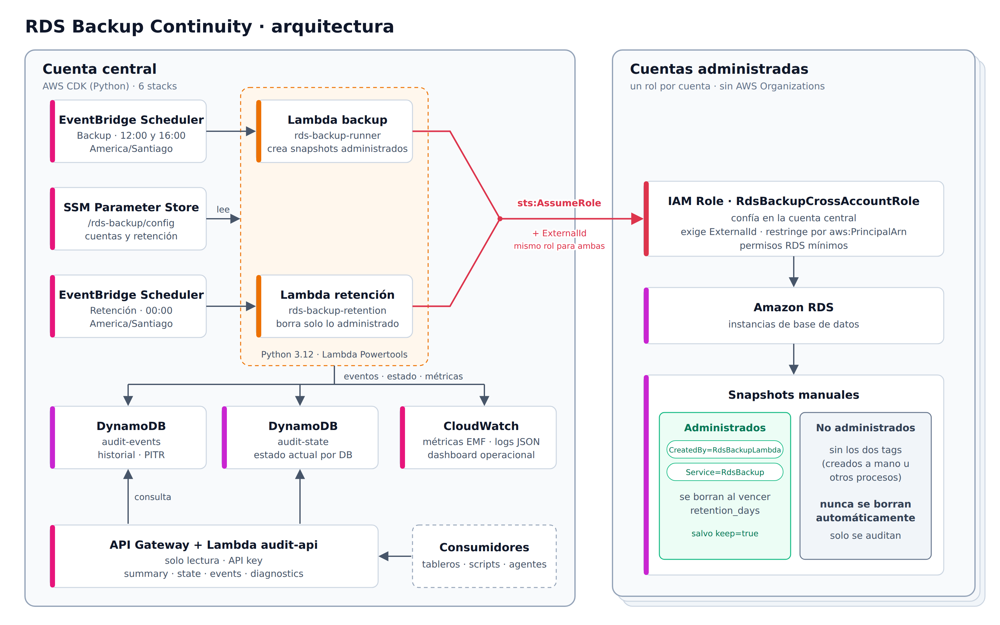

# RDS Backup Continuity

Solución serverless para administrar snapshots manuales de Amazon RDS en múltiples cuentas AWS desde una cuenta central, usando roles cross-account en lugar de AWS Organizations para la operación diaria.

La solución:

- Crea snapshots RDS programados en cada cuenta administrada.
- Aplica retención **solo** sobre los snapshots que la propia solución creó.
- Registra cada evento (backup, omisión, error, eliminación) y el estado actual por base de datos en DynamoDB.
- Expone una API de solo lectura para consultar la auditoría desde tableros, scripts o agentes.
- Publica métricas y un dashboard en CloudWatch.

> Este repositorio es una versión sanitizada de una solución que opera en producción. Los IDs de cuenta, nombres de proyectos y endpoints son ficticios.

## Problema

En organizaciones con varias cuentas AWS, cada equipo suele resolver sus respaldos a su manera. Eso deja preguntas difíciles de responder:

- ¿Todas las bases tienen un snapshot reciente?
- ¿Qué cuenta falló anoche y por qué?
- ¿Qué snapshots se pueden borrar sin riesgo y cuáles fueron creados a mano para una investigación o un cambio?

Los backups automáticos de RDS cubren la recuperación a un punto en el tiempo, pero no dan snapshots de control en horarios definidos ni una vista central entre cuentas. Este proyecto resuelve eso desde una sola cuenta central.

## Arquitectura



Fuente editable: [`docs/images/architecture.svg`](docs/images/architecture.svg).

## Componentes

| Stack | Propósito |
| --- | --- |
| `RdsAuditStack` | Tablas DynamoDB de eventos y estado. |
| `RdsRetentionStack` | Publica la configuración en SSM, crea la Lambda de retención y su schedule diario. |
| `RdsBackupStack` | Crea la Lambda de backup y sus schedules. |
| `RdsAuditApiStack` | API Gateway con API key para consultar la auditoría. |
| `RdsObservabilityStack` | Dashboard CloudWatch con métricas operativas. |
| `RdsTargetAccountRoleStack` | Rol cross-account que se despliega en cada cuenta administrada. |

Estructura del repositorio:

```text
app.py                  # Entrada CDK
stacks/                 # Stacks CDK y configuración de infraestructura
lambda/
  backup/handler.py     # Crea snapshots
  retention/handler.py  # Elimina snapshots administrados y vencidos
  audit_api/handler.py  # API de consulta
  common/               # Config, AssumeRole, logging y auditoría compartidos
config/                 # Cuentas administradas por ambiente
tests/unit/             # Pruebas de handlers y stacks
bruno/                  # Colección Bruno para probar la API
docs/agent-contract.md  # Contrato de la API para agentes
```

## Requisitos

- Python 3.12
- AWS CDK v2 (`npm install -g aws-cdk`)
- Docker (lo usa `PythonFunction` para empaquetar las Lambdas)
- Credenciales para la cuenta central y para cada cuenta administrada
- Cuentas con CDK bootstrap (`cdk bootstrap`)

## Configuración

Las cuentas administradas se definen en `config/accounts.<ambiente>.json`. El ambiente se elige con `RDS_BACKUP_ENV` (por defecto `qa`).

```json
{
  "default_retention_days": 7,
  "accounts": {
    "210000000001": {
      "account_name": "app-a",
      "enabled": true,
      "backup_enabled": true,
      "retention_enabled": true,
      "retention_days": 3
    }
  }
}
```

| Campo | Descripción |
| --- | --- |
| `account_name` | Alias corto de la cuenta o proyecto. Se usa en la API y en la auditoría. |
| `enabled` | Habilita o deshabilita la cuenta completa. |
| `backup_enabled` | Permite crear snapshots en la cuenta. |
| `retention_enabled` | Permite ejecutar la retención en la cuenta. |
| `retention_days` | Días que se conservan los snapshots administrados. |

El stack publica este JSON en SSM Parameter Store (`/rds-backup/config`) y las Lambdas lo leen en cada ejecución. Agregar, pausar o cambiar la retención de una cuenta no requiere tocar el código: se edita el JSON y se vuelve a desplegar, lo que también actualiza los permisos `sts:AssumeRole` de las Lambdas.

Variables de entorno usadas por CDK:

| Variable | Uso |
| --- | --- |
| `RDS_BACKUP_ENV` | Ambiente (`qa`, `prod`, ...). Selecciona `config/accounts.<env>.json`. |
| `RDS_BACKUP_CENTRAL_ACCOUNT_ID` | ID de la cuenta central. Se usa en la trust policy y en el `ExternalId`. |
| `RDS_BACKUP_ACCOUNTS_CONFIG` | Ruta alternativa al archivo de cuentas (opcional). |

Los horarios se definen en `stacks/config.py` (`CRON_SCHEDULES`, `CRON_SCHEDULE_RETENTION`, `SCHEDULE_TIMEZONE`).

## Seguridad

- La cuenta central asume `RdsBackupCrossAccountRole` en cada cuenta administrada con `sts:AssumeRole` y un `ExternalId` (`rds-backup-<central-account-id>`).
- La trust policy del rol destino exige el `ExternalId` y limita `aws:PrincipalArn` a los roles de ejecución de las Lambdas de backup y retención.
- Las Lambdas solo pueden asumir los roles de las cuentas listadas en la configuración.
- El rol destino tiene únicamente los permisos RDS necesarios: describir instancias y snapshots, crear y etiquetar snapshots y eliminar snapshots.
- La API de auditoría es de solo lectura y requiere API key. En el escenario actual, la API key identifica al consumidor y permite aplicar el usage plan, pero no constituye autenticación fuerte ni autorización por usuario: quien obtenga la key puede consultar la API como ese consumidor.
- Si la API se expone públicamente, debe complementarse con controles adicionales, como una resource policy, AWS WAF, restricciones de red o un mecanismo de autenticación como IAM/SigV4, Amazon Cognito o un Lambda authorizer.
- Para la operación actual se recomienda configurar throttling y cuotas en el usage plan, rotar la API key periódicamente, revisar los logs de acceso y evitar exponer información sensible en las respuestas.
- La solución no usa la API key para ejecutar operaciones destructivas: todos los endpoints publicados son de consulta y la Lambda de auditoría solo tiene permisos `GetItem`, `Query` y `Scan` sobre las tablas de auditoría.

## Retención segura

La retención solo elimina snapshots manuales que tengan **ambos** tags creados por la solución:

```text
CreatedBy=RdsBackupLambda
Service=RdsBackup
```

Los snapshots sin esos tags se omiten y quedan auditados como `unmanaged`. Para conservar un snapshot administrado más allá de su ventana, basta con agregar:

```text
keep=true
```

Cada omisión queda registrada con su motivo (`unmanaged`, `keep_tag` o `not_expired`), de modo que siempre se puede explicar por qué un snapshot no se borró.

## Auditoría

| Tabla | Propósito |
| --- | --- |
| `rds-backup-audit-events` | Historial de eventos: backups, omisiones, errores y eliminaciones. Tiene PITR habilitado. |
| `rds-backup-audit-state` | Estado actual por cuenta, región y base de datos. Es derivado y se puede reconstruir desde los eventos, por eso no usa PITR. |

Ambas usan `pk`/`sk` y un índice `gsi1` para consultar por alias de cuenta.

Endpoints de la API (todos `GET` y con `x-api-key`):

```text
/audit/summary
/audit/state
/audit/state/{account_name}
/audit/state/{account_name}/{region}/{db_identifier}
/audit/events
/audit/events/{account_name}
/audit/diagnostics/health
/audit/diagnostics/retention
/audit/diagnostics/account/{account_name}
/audit/diagnostics/databases/{account_name}
/audit/diagnostics/database/{account_name}/{region}/{db_identifier}
/audit/diagnostics/restore-candidates/{account_name}/{region}/{db_identifier}
/audit/diagnostics/operation/{operation_id}
```

Los endpoints `diagnostics` devuelven respuestas ya agregadas para que un agente o un tablero no tenga que orquestar varias llamadas. Ver `docs/agent-contract.md`.

Los resúmenes y diagnósticos recorren todas las páginas de DynamoDB dentro del rango pedido. Pasa siempre `from` y `to` (ISO-8601 UTC): sin rango, la consulta abarca todo el historial. `restore-candidates` excluye los snapshots que la retención ya eliminó.

## Observabilidad

Namespace CloudWatch: `RdsBackup`.

| Métrica | Dimensión `service` | Descripción |
| --- | --- | --- |
| `SnapshotsCreatedTotal` | `RdsBackup` | Snapshots creados. |
| `SkippedInvalidState` | `RdsBackup` | Instancias omitidas por estado no disponible. |
| `SnapshotErrors` | `RdsBackup` | Errores durante el backup. |
| `MissingBackupRole` | `RdsBackup` | Cuentas sin rol o sin permiso para backup. |
| `SnapshotsDeleted` | `RdsRetention` | Snapshots eliminados por retención. |
| `SnapshotErrors` | `RdsRetention` | Errores durante la retención. |
| `MissingRetentionRole` | `RdsRetention` | Cuentas sin rol o sin permiso para retención. |

Los logs son JSON estructurado con AWS Lambda Powertools e incluyen `step`, `location` y un `operation_id` por ejecución.

## Despliegue

```bash
python3 -m venv .venv
source .venv/bin/activate
pip install -r requirements.txt -r requirements-dev.txt
```

1. En cada cuenta administrada (autenticado contra esa cuenta):

```bash
RDS_BACKUP_ENV=qa RDS_BACKUP_CENTRAL_ACCOUNT_ID=<central-account-id> \
  cdk deploy RdsTargetAccountRoleStack
```

2. En la cuenta central:

```bash
RDS_BACKUP_ENV=qa RDS_BACKUP_CENTRAL_ACCOUNT_ID=<central-account-id> \
  cdk deploy RdsAuditStack RdsRetentionStack RdsBackupStack RdsAuditApiStack RdsObservabilityStack
```

Si una cuenta aún no tiene el rol, la ejecución no falla: registra `ASSUME_ROLE_FAILED` en la auditoría, publica `MissingBackupRole` o `MissingRetentionRole` y continúa con las demás cuentas.

## Validación

Invocar el runner manualmente:

```bash
aws lambda invoke \
  --function-name rds-backup-runner \
  --payload '{}' \
  --cli-binary-format raw-in-base64-out \
  /tmp/rds-backup-runner-response.json
```

Revisar los snapshots creados en las últimas 3 horas:

```bash
aws cloudwatch get-metric-statistics \
  --namespace RdsBackup \
  --metric-name SnapshotsCreatedTotal \
  --dimensions Name=service,Value=RdsBackup \
  --start-time "$(date -u -d '3 hours ago' +%Y-%m-%dT%H:%M:%SZ)" \
  --end-time "$(date -u +%Y-%m-%dT%H:%M:%SZ)" \
  --period 300 \
  --statistics Sum
```

`list-metrics` solo confirma que la serie existe. Para saber si hubo ejecuciones recientes hay que consultar datapoints con `get-metric-statistics` en el período correcto.

Consultar la API:

```bash
curl -H "x-api-key: <api-key>" \
  "https://<api-id>.execute-api.<region>.amazonaws.com/qa/audit/diagnostics/health"
```

La carpeta `bruno/rds-backup-audit-api` tiene una colección [Bruno](https://www.usebruno.com/) lista para usar. Copia `environments/example.bru` a `environments/qa.bru` y completa los valores; ese archivo está en `.gitignore`.

## Tests

```bash
AWS_DEFAULT_REGION=us-east-1 pytest -q
```

Los tests de stacks sintetizan los templates CloudFormation y validan roles, schedules, permisos y variables de entorno. Los tests de handlers usan clientes AWS simulados.

## Costos

Los componentes son serverless y de pago por uso: Lambda, EventBridge Scheduler, DynamoDB on-demand, API Gateway y CloudWatch. El costo principal suele ser el **almacenamiento de los snapshots**, que crece con la cantidad de bases, la frecuencia de backup y los días de retención. Revisa `retention_days` antes de habilitar cuentas grandes.

## Limitaciones conocidas

- **Una región:** el cliente RDS se crea en la región donde corre la Lambda. Las bases en otras regiones no se respaldan.
- **Sin paginación:** `describe_db_instances` y `describe_db_snapshots` leen solo la primera página (hasta 100 elementos). Las cuentas con más recursos necesitan paginators.
- **Aurora:** las instancias de un cluster Aurora aparecen en `describe_db_instances`, pero requieren `create_db_cluster_snapshot`. Hoy esas instancias quedan registradas como error.
- **Ejecución secuencial:** las cuentas se procesan una tras otra dentro del timeout de 5 minutos de la Lambda.
- **Sin alertas automáticas:** hay métricas y dashboard, pero todavía no hay alarmas ni notificaciones.
- **Resúmenes de períodos largos:** sin filtro de cuenta, la API hace un scan de la tabla de eventos y filtra por fecha. Un mes responde dentro del límite de API Gateway (29 s), pero varios meses pueden superarlo.

## Próximos pasos

- Alarmas CloudWatch y notificaciones con Amazon SNS.
- Paginación, soporte multi-región y snapshots de cluster Aurora.
- Autenticación más fuerte para la API.
- Pruebas end-to-end con cuentas sandbox.

## Licencia

MIT. Ver [LICENSE](LICENSE).
